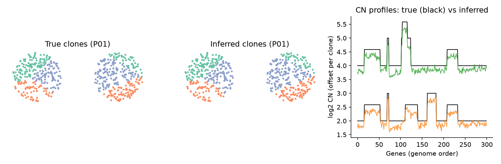

# cosmx-cnv

Bayesian inference of clonal copy number variation (CNV) from CosMX spatial transcriptomics.

Cells are clustered into subclones, each with its own copy-number profile, using a
Pyro mixture model over single-cell counts. Two smoothness priors make this work at
CosMX's sparse counts: spatially neighbouring cells tend to share a clone, and
genomically neighbouring genes tend to share a copy-number state.



## Install

```bash
git clone https://github.com/<you>/cosmx-cnv.git
cd cosmx-cnv
pip install -e .
```

Requires Python ≥ 3.9 and PyTorch (CPU or CUDA).

## Quickstart

```python
import cosmx_cnv as cc

sim = cc.simulate_dataset(n_patients=3, n_cores_per_patient=2, n_genes=300)  # or your own data
adata, gene_coords = sim["adata"], sim["gene_coords"]

data_dict = {c: cc.prepare_chromosome_data(c, {"Cancer": adata}, gene_coords)
             for c in gene_coords["chromosome"].unique()}
md = cc.prepare_data(data_dict, device="cpu")

model = cc.CNVModel(cc.CNVModelConfig(num_components=3, spatial_penalty=1.0,
                                      gene_proximity_penalty=80,
                                      spatial_decay_scale=400, gene_decay_scale=3e6))
model.fit(md["y_counts"], num_iterations=1000, lr=0.05,
          r_init=md["y_counts"].log1p().mean(0, keepdim=True),
          cell_neighbours_adj=md["cell_adjacency"], cell_neighbours_dist=md["cell_distances"],
          gene_neighbours_adj=md["gene_adjacency"], gene_neighbours_dist=md["gene_distances"],
          core_ids=md["cell_core_ids"], patient_ids=md["cell_patient_ids"])

membership = model.get_membership_probs()       # cells x K   (cells in md["cell_names"] order)
profiles = model.get_parameters()["s_loc"]      # patients x K x genes (log scale)
```

## Examples

The first two run on simulated data in under a minute on a laptop; all write to `./outputs/`:

| Script | What it shows |
|---|---|
| [`examples/01_gene_selection.py`](examples/01_gene_selection.py) | Choosing CN-responsive genes from paired bulk sWGS and CosMX data |
| [`examples/02_cnv_inference.py`](examples/02_cnv_inference.py) | Fitting the model and comparing inferred clones and CN profiles with the truth |
| [`examples/03_real_data.py`](examples/03_real_data.py) | Two real tumour cores: each splits into a tumour clone and a CN-neutral clone matching annotated benign epithelium (data file not distributed) |

```bash
python examples/01_gene_selection.py
python examples/02_cnv_inference.py
```

## Input format

**`adata`** (AnnData, raw counts, cells × genes), restricted to the cells to model
(e.g. cancer cells), with these `obs` columns:

| column | type | meaning |
|---|---|---|
| `patient.id` | categorical | patient / tumour; each gets its own clone profiles |
| `core_id` | categorical | tissue core; modelled as a per-core expression bias |
| `CenterX_global_px`, `CenterY_global_px` | float | cell centroid in pixels |
| `tma_id` | categorical, optional | slide/TMA; adds a per-slide bias, and spatial neighbours are never linked across slides |

**`gene_coords`** (DataFrame): `gene_symbol`, `chromosome` (string, e.g. `"1"`),
`start`, `end` (GRCh38). `cc.lookup_ensembl_coordinates(symbols)` builds this from
gene symbols, and `cc.align_panel_genes(adata, gene_coords)` reconciles it with
the panel's `var_names`.

For gene selection you also need a **segment table** from bulk sWGS (QDNAseq or
similar) with `Chromosome`, `Start_Position`, `End_Position`, `Patient_ID` and
`SegmentMean` (log2 ratio).

## Workflow

1. **Gene selection.** Only some genes' expression tracks their copy number. For each gene,
   `bootstrap_all_genes` fits `mu(x) = log(1 + b + alpha * 2^(gamma * x))` between
   bulk CN `x` and pseudobulk expression across patients, with patient bootstrap.
   `filter_genes_by_bootstrap` keeps genes with consistent sign (`support`) and good
   fit (`unexplained_mean`). There is also a CLI:
   `cosmx-cnv-bootstrap --expr_csv expr.csv --cn_csv cn.csv --outdir out/`.
2. **CNV inference.** `prepare_chromosome_data` → `prepare_data` → `CNVModel.fit`,
   run on the selected genes.

## Model

For patient *p*, component *k*, cell *c* and gene *g*:

- `π_p ~ Dirichlet(1)`, `z_c ~ Categorical(π_p(c))`
- `σ_pk ~ Exponential(30 if k = 0 else 10)`, `s_pkg ~ Laplace(0, σ_pk)` (component 0 is pushed towards neutral)
- `y_cg ~ Poisson(exp(s_p(c), z_c, g + r_g + core_bias + cell_sensitivity_c))`, or Gamma-Poisson

Smoothness enters as penalties weighted by a Matérn-3/2 kernel
`(1 + √3 d/ℓ) exp(−√3 d/ℓ)`:

- **genomic**, on `(s_pki − s_pkj)²` for neighbouring genes (`gene_proximity_penalty`, `gene_decay_scale` in bp);
- **spatial**, on the variational assignment logits of neighbouring cells (`spatial_penalty`, `spatial_decay_scale` in px).

Assignments `z` are enumerated exactly with `TraceEnum_ELBO`. Training uses
gradient clipping plus a NaN guard that rolls back bad steps.

### Reference (normal) cells

Cells known to be normal can be pinned to a component with a fixed profile:

```python
ref = {"masks": {0: adata.obs["is_normal"].to_numpy()},            # component -> bool per cell
       "profiles": {0: {pid: pd.Series(0.0, index=gene_coords["gene_symbol"])
                        for pid in adata.obs["patient.id"].cat.categories}}}
data_dict = {c: cc.prepare_chromosome_data(c, {"Cancer": adata}, gene_coords, reference_config=ref) ...}
md = cc.prepare_data(data_dict)
model = cc.CNVModel(cc.CNVModelConfig(..., use_reference=True))
model.fit(..., reference_config=md["reference_config"])
```

## Package layout

```
src/cosmx_cnv/
    _config.py          CNVModelConfig, pixel/µm conversion
    _model.py           CNVModel (Pyro model, guide, training)
    _data.py            per-chromosome prep, spatial & genomic neighbour graphs
    _gene_selection.py  sWGS segment → gene CN mapping, pseudobulk, gene filter
    bootstrap.py        CN–expression dose-response bootstrap
    _results.py         per-patient clone CN tables
    simulate.py         synthetic CosMX-like data with known clones
    _cli.py             cosmx-cnv-bootstrap
    tools/              Ensembl lookup, fixed-bandwidth KDE, hg38 reference
```

## Tests

```bash
pip install -e ".[test]"
pytest
```

## License

MIT, see [LICENSE](LICENSE).
