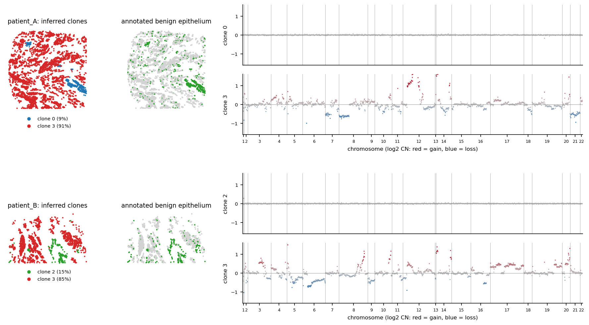

# cosmx-cnv

Bayesian inference of clonal copy number variation (CNV) from CosMX spatial transcriptomics.

Calling CNVs from single-cell and spatial transcriptomics is a common
task ([inferCNV](https://github.com/broadinstitute/inferCNV);
[Gao et al. 2021](https://doi.org/10.1038/s41587-020-00795-2);
[Erickson et al. 2022](https://doi.org/10.1038/s41586-022-05023-2)). On CosMX 6k panels, however,
common tools performed poorly: counts are sparse and the panel's genes are unevenly spread across
the genome, which directly violates their assumptions. We therefore built a Bayesian model tailored
to CosMX 6k data that:

1. smooths clone assignments in space, countering the sparse per-cell signal;
2. encourages genes that lie close together on the genome to share a copy-number state,
   handling sparse and unevenly distributed probes;
3. runs only on preselected genes whose expression is proportional to copy number.


*Simulated data ([`examples/02_cnv_inference.py`](examples/02_cnv_inference.py)): true and inferred
clones in space, and each clone's inferred log2 CN ratio per gene against the truth.*


*Real data ([`examples/03_real_data.py`](examples/03_real_data.py)): two breast tumour cores
from the Madrid dataset. Each splits into an aneuploid tumour clone and a CN-neutral clone that coincides with the
epithelium annotated as benign.*

## Install

```bash
git clone https://github.com/cancersysbio/cosmx-cnv.git
cd cosmx-cnv
pip install -e .
```

Requires Python ≥ 3.9 and PyTorch (CPU or CUDA).

## Quickstart

```python
import cosmx_cnv as cc

sim = cc.simulate_dataset(n_patients=3, n_cores_per_patient=2, n_genes=300)  # or your own data
adata, gene_coords = sim["adata"], sim["gene_coords"]

data_dict = {c: cc.prepare_chromosome_data(c, {"Cancer": adata}, gene_coords)
             for c in gene_coords["chromosome"].unique()}
md = cc.prepare_data(data_dict, device="cpu")

model = cc.CNVModel(cc.CNVModelConfig(num_components=3, spatial_penalty=1.0,
                                      gene_proximity_penalty=80,
                                      spatial_decay_scale=400, gene_decay_scale=3e6))
model.fit(md["y_counts"], num_iterations=1000, lr=0.05,
          r_init=md["y_counts"].log1p().mean(0, keepdim=True),
          cell_neighbours_adj=md["cell_adjacency"], cell_neighbours_dist=md["cell_distances"],
          gene_neighbours_adj=md["gene_adjacency"], gene_neighbours_dist=md["gene_distances"],
          core_ids=md["cell_core_ids"], patient_ids=md["cell_patient_ids"])

membership = model.get_membership_probs()       # cells x K   (cells in md["cell_names"] order)
profiles = model.get_parameters()["s_loc"]      # patients x K x genes (log scale)
```

## Examples

The first two run on simulated data in under a minute on a laptop; all write to `./outputs/`:

| Script | What it shows |
|---|---|
| [`examples/01_gene_selection.py`](examples/01_gene_selection.py) | Selecting CN-responsive genes from paired bulk sWGS and CosMX data, with the breast-cancer thresholds |
| [`examples/02_cnv_inference.py`](examples/02_cnv_inference.py) | Fitting the model and comparing inferred clones and CN profiles with the truth |
| [`examples/03_real_data.py`](examples/03_real_data.py) | Two real tumour cores: each splits into a tumour clone and a CN-neutral clone matching annotated benign epithelium (data file not distributed) |

```bash
python examples/01_gene_selection.py
python examples/02_cnv_inference.py
```

## Input format

**`adata`** (AnnData, raw counts, cells × genes), restricted to the cells to model
(e.g. cancer cells), with these `obs` columns:

| column | type | meaning |
|---|---|---|
| `patient.id` | categorical | patient / tumour; each gets its own clone profiles |
| `core_id` | categorical | tissue core; modelled as a per-core expression bias |
| `CenterX_global_px`, `CenterY_global_px` | float | cell centroid in pixels |
| `tma_id` | categorical, optional | slide/TMA; adds a per-slide bias, and spatial neighbours are never linked across slides |

**`gene_coords`** (DataFrame): `gene_symbol`, `chromosome` (string, e.g. `"1"`),
`start`, `end` (GRCh38). `cc.lookup_ensembl_coordinates(symbols)` builds this from
gene symbols, and `cc.align_panel_genes(adata, gene_coords)` reconciles it with
the panel's `var_names`.

For your own gene selection you also need a **segment table** from bulk sWGS (QDNAseq or
similar) with `Chromosome`, `Start_Position`, `End_Position`, `Patient_ID` and
`SegmentMean` (log2 ratio).

## Workflow

### 1. Gene selection

Only some genes' expression tracks their copy number: across large pan-cancer cohorts,
copy-number changes shift the expression of only a subset of genes, often less than
proportionally ([Bhattacharya et al. 2020](https://doi.org/10.1038/s41467-020-14605-5)).
Therefore we select well-behaving genes for the cohort and run inference on those only.

**Breast cancer: use the shipped list.** For breast cancer we had shallow whole-genome sequencing
(sWGS) and CosMX 6k data for the same 117 tumours of the Madrid TMA cohort. The 1443 genes
selected there ship with the package:

```python
gene_coords = cc.load_breast_cancer_genes()  # gene_symbol, ensembl_id, chromosome, start, end
```

**Other cancers or panels: select from your own paired data.** You need bulk CN segments
(sWGS, QDNAseq or similar) and CosMX data for the same patients:

```python
gene_cn = cc.get_gene_cnv_data(gene_coords, segments)          # gene_coords: all panel genes
cn_table = gene_cn.pivot_table(values="SegmentMean", index="gene_symbol", columns="Patient_ID").T
expr_table = cc.pseudobulk_expression(adata, groupby="patient.id")  # cancer cells, patients x genes
fits = cc.fit_cn_expression_trends(cn_table, expr_table)
good_genes = cc.filter_genes_by_trend(fits, gene_coords, r2_threshold=0.2, max_slope=5)
```

For each gene, `fit_cn_expression_trends` regresses patient pseudobulk expression (the mean of
`log(x/s + 1)` over cancer cells, with size factor `s` = library size / 10⁴) on the sWGS log2 CN
ratio through a Poisson log-linear mean, `E[log(1 + Y)]` with `Y ~ Poisson(exp(b0 + b1·CN))`.
`filter_genes_by_trend` uses the following thresholding:

| criterion | threshold | why |
|---|---|---|
| lower 95% CI of slope `b1` | > 0 | expression rises with copy number |
| R² of the fit | > 0.2 | CN explains a useful share of across-patient variation |
| upper 95% CI of slope `b1` | < 5 | drops unstable fits on genes with little CN variation |

`examples/01_gene_selection.py` runs this on simulated data with a known set of CN-responsive genes.

### 2. CNV inference

`prepare_chromosome_data` → `prepare_data` → `CNVModel.fit`, run on the selected genes
(see Quickstart and `examples/02_cnv_inference.py`).

We advise fitting jointly on as many TMAs as possible. The per-gene coefficients are shared by
all cells, so more data calibrates them better, and the model is then better at splitting
subclones.

## Model

The model is fitted by stochastic variational inference (Pyro SVI with Adam): a variational
guide approximates the posterior over clone profiles, mixing proportions, per-gene baselines,
biases and per-cell assignment logits, and training maximises the ELBO.

For patient *p*, component *k*, cell *c* and gene *g*:

- `π_p ~ Dirichlet(1)`, `z_c ~ Categorical(π_p(c))`
- `σ_pk ~ Exponential(30 if k = 0 else 10)`, `s_pkg ~ Laplace(0, σ_pk)` (component 0 is pushed towards neutral)
- `y_cg ~ Poisson(exp(s_p(c), z_c, g + r_g + core_bias + cell_sensitivity_c))`, or Gamma-Poisson

Smoothness enters as penalties weighted by a Matérn-3/2 kernel
`(1 + √3 d/ℓ) exp(−√3 d/ℓ)`:

- **genomic**, on `(s_pki − s_pkj)²` for neighbouring genes (`gene_proximity_penalty`, `gene_decay_scale` in bp);
- **spatial**, on the variational assignment logits of neighbouring cells (`spatial_penalty`, `spatial_decay_scale` in px).

Assignments `z` are marginalised exactly in the ELBO by enumeration (`TraceEnum_ELBO`). Training uses
gradient clipping plus a NaN guard that rolls back bad steps.

### Reference (normal) cells

Cells known to be normal can be pinned to a component with a fixed profile:

```python
ref = {"masks": {0: adata.obs["is_normal"].to_numpy()},            # component -> bool per cell
       "profiles": {0: {pid: pd.Series(0.0, index=gene_coords["gene_symbol"])
                        for pid in adata.obs["patient.id"].cat.categories}}}
data_dict = {c: cc.prepare_chromosome_data(c, {"Cancer": adata}, gene_coords, reference_config=ref) ...}
md = cc.prepare_data(data_dict)
model = cc.CNVModel(cc.CNVModelConfig(..., use_reference=True))
model.fit(..., reference_config=md["reference_config"])
```

## Package layout

```
src/cosmx_cnv/
    _config.py          CNVModelConfig, pixel/µm conversion
    _model.py           CNVModel (Pyro model, guide, training)
    _data.py            per-chromosome prep, spatial & genomic neighbour graphs
    _gene_selection.py  sWGS segment → gene CN, pseudobulk, CN–expression fits, gene filter
    data/               breast-cancer CN-responsive gene list
    _results.py         per-patient clone CN tables
    simulate.py         synthetic CosMX-like data with known clones
    tools/              Ensembl lookup, fixed-bandwidth KDE, hg38 reference
```

## References

- Bhattacharya A. *et al.* Transcriptional effects of copy number alterations in a large set of
  human cancers. *Nat. Commun.* **11**, 715 (2020). https://doi.org/10.1038/s41467-020-14605-5
- Erickson A. *et al.* Spatially resolved clonal copy number alterations in benign and malignant
  tissue. *Nature* **608**, 360–367 (2022). https://doi.org/10.1038/s41586-022-05023-2
- Gao R. *et al.* Delineating copy number and clonal substructure in human tumors from single-cell
  transcriptomes. *Nat. Biotechnol.* **39**, 599–608 (2021). https://doi.org/10.1038/s41587-020-00795-2

## License

MIT, see [LICENSE](LICENSE).
